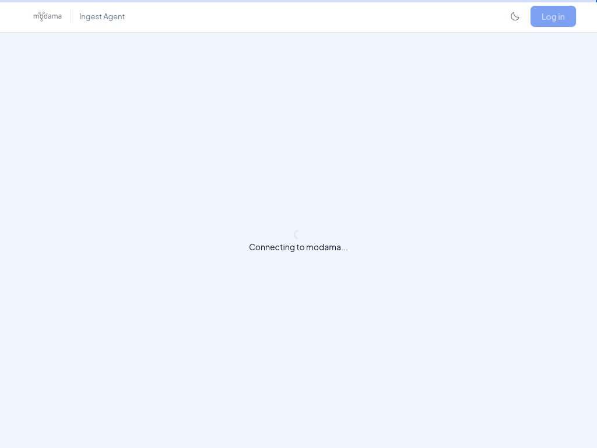
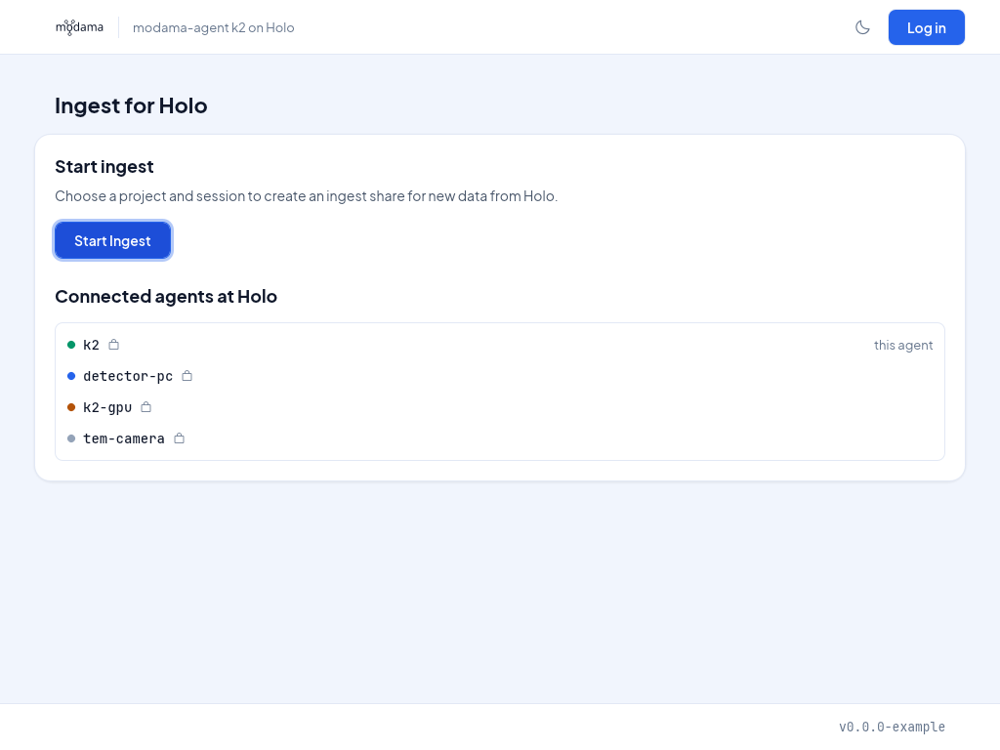
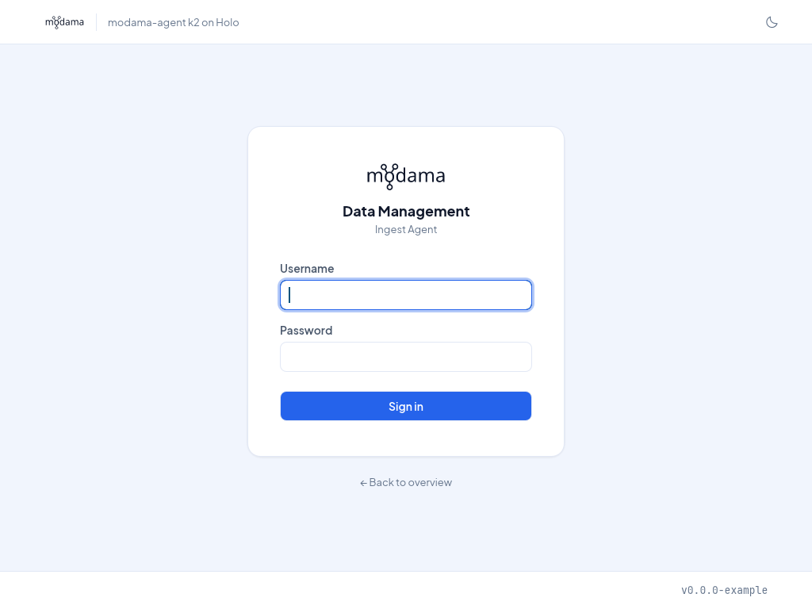
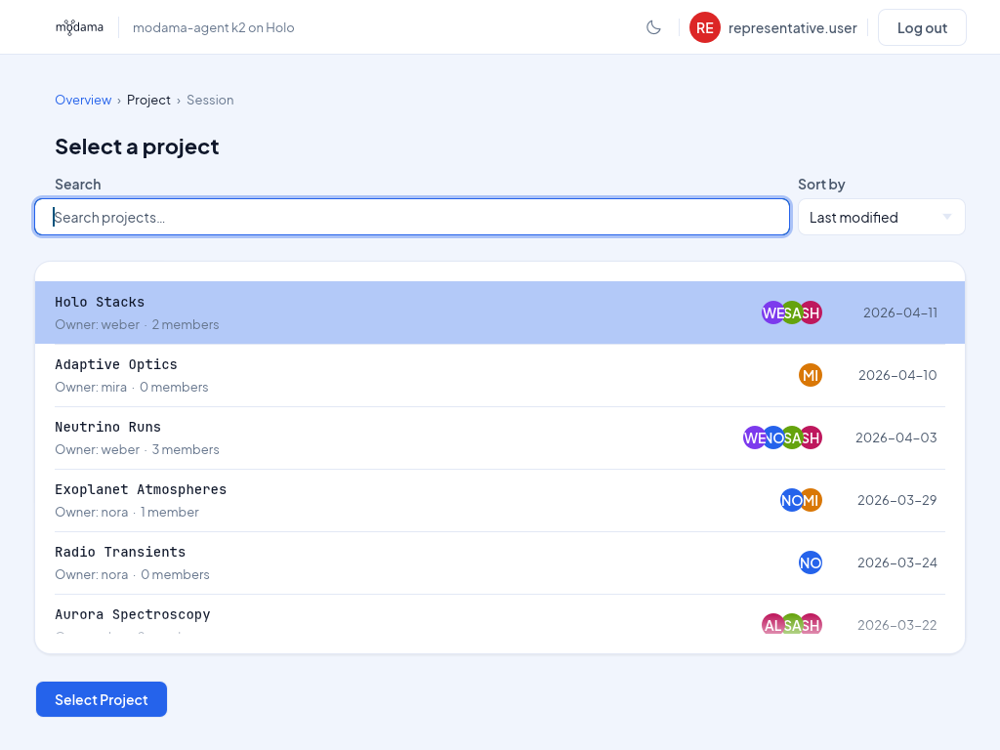
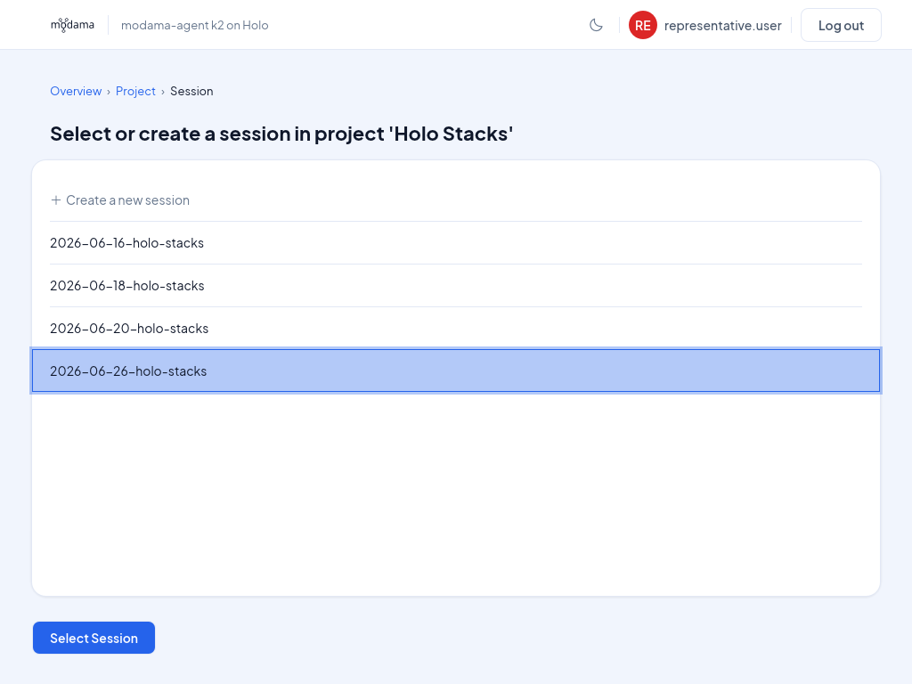
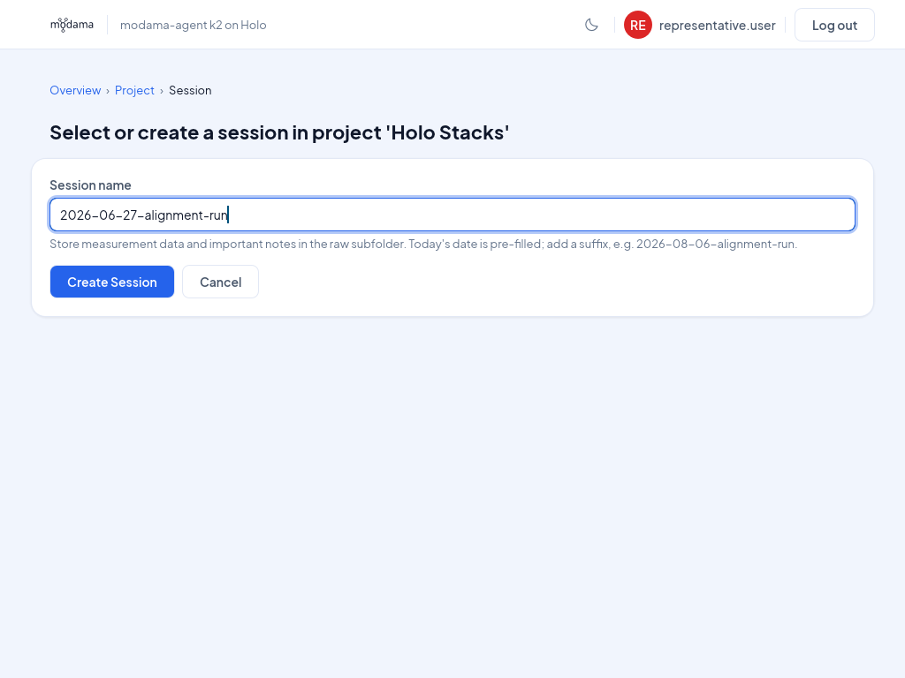
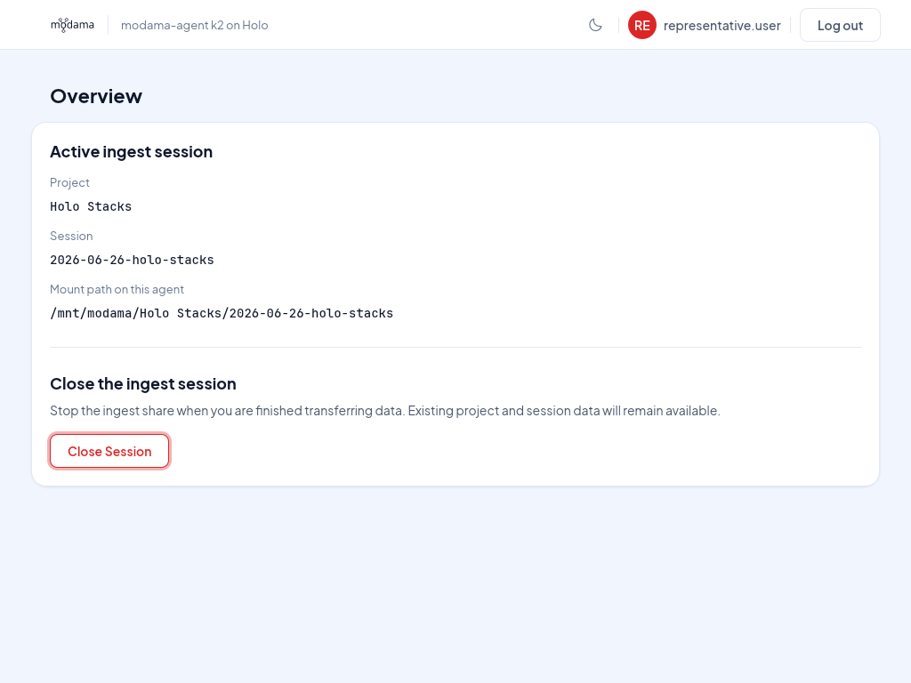

# `modama-agent` - getting data into `modama`

To ingest data into `modama`, we provide a small software called `modama-agent`.
Using `modama-agent`, you can create a networked session folder, which we call
an "ingest share". 

Usually, this software will be installed by an administrator at the computers that belong to
scientific instruments, and you only need to start the graphical user interface.
It is also possible to participate with your own laptop in the data management
session of an experiment, but this is not yet recommended.

## How to create an ingest share

- Step 1: start the `modama-agent` GUI





- Step 2: log in



- Step 3: select a project

Select a project from the list - either one you own, or where you are a member. When this page
opens, you can directly start to type to filter the project list by name. You can double click the
project in the list, or continue by clicking the "Select Project" button.



- Step 4: enter session details or select existing session

Select a session folder where your data should be stored inside the just selected project.
Usually, a new session at an instrument also means a new session should be created,
but you can also ingest data into an existing session, for example if the ingest process
was interrupted for any reason.



When choosing to create a new session, you can choose a name in the following step.
The field is pre-filled with today's date, which you can use as a prefix if that fits
your data organisation scheme.



Once you have completed these steps, the system might be busy for a bit, and then,
the selected session folder should be available as an ingest share, either as a
mapped network drive on Windows, or as a mounted network filesystem under Linux.



Where exactly your ingest share is mounted depends on your operating system and its version.
It should also show up in your normal file manager as a network drive or location.
As shown above, you can use the "Copy" button to copy its path into the clipboard,
or "Open folder" to open your ingest share with a file manager.

The ingest share is not only available on the computer where you just created it,
but also on other computers that belong to the same scientific instrument.

You can see the list of other connected computers ("agents") on the overview page,
which also gives you information on how to upload your data into your ingest share.

## How to upload data to the ingest share

The ingest share should automatically open on all data-producing systems. On
Windows, it will be mapped as a network drive (for example `Z:\`). Simply save
your data on this network drive, or copy/drag it there, as normal,
and it will be stored in the data management.

## Automation: how to get the current session folder?

If you would like to integrate data management into your automation, for example
into an acquisition script or notebook, this is easily possible! `modama-agent`
provides a local HTTP API on port 3003, which you can query for the
ingest share that was created last. We call this the "foreground share".
The GUI has ready-made Python code for this: on the ingest page,
click "Use in Python" below the mount path. The code looks like this:

```python
# The session folder for new data (the foreground ingest),
# from the modama agent on this computer. Run this before you
# start saving.
import json
import pathlib
import urllib.request

url = "http://localhost:3003/api/shares/foreground/"
headers = {"X-API-Version": "1.0.0"}
request = urllib.request.Request(url, headers=headers)
with urllib.request.urlopen(request, timeout=10) as response:
    share = json.load(response)
if "mount_path" not in share:
    reason = share.get("message", "No foreground ingest.")
    raise RuntimeError(reason)
session_folder = share["mount_path"]
raw_folder = pathlib.Path(session_folder) / "raw"
```

You can use this code for example in a Jupyter notebook.

## Stopping the ingest

At the end of your session, it is your responsibility to stop the ingest share. You can do this with
the "Stop Ingest" button on the overview page:


After you click that button, you get a confirmation dialog:

TODO: confirmation dialog screenshot here, add it to the snapshot generator

After closing ingest, the data you uploaded to the data management is still
available via the normal data access methods (TODO: link), just no longer
via the network drive or mount path at the
scientific instrument where you have just uploaded it from.

You can now log out, and the next user can start their work.

## Hand-off from one user to another

If everyone follows the steps from the previous section, the hand-off from one
user to the next is easy: they just start their own ingest share. Should
another ingest share from a previous user still be mounted, the new user
can close the still-connected ingest share.

> [!TIP]
> To make this easier for everyone involved, transfer or save any
> data you record into your ingest share 
> while your experiment is running - that way, you don't have
> to stay longer just for data transfer, or interrupt the beginning
> of the next user's instrument session.
